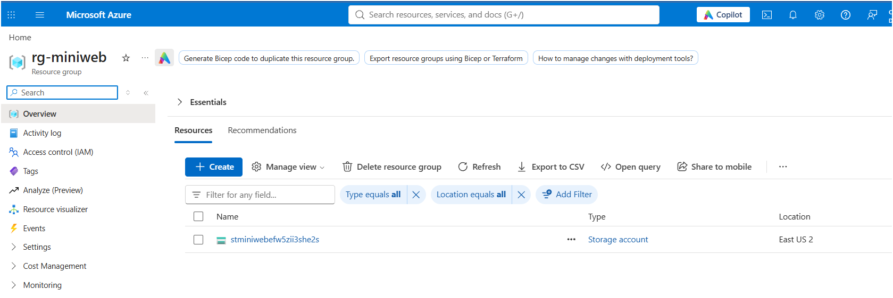
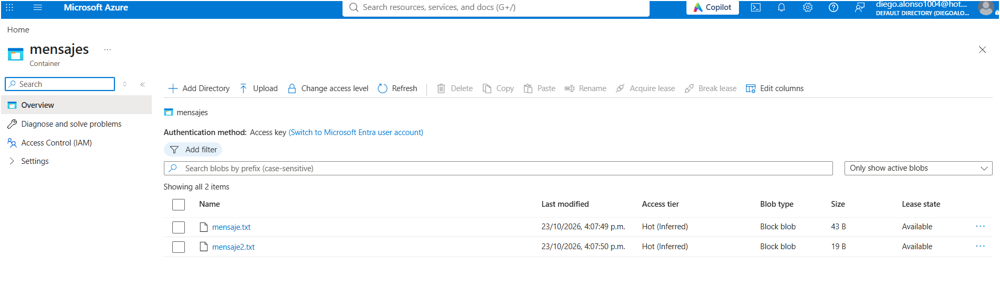
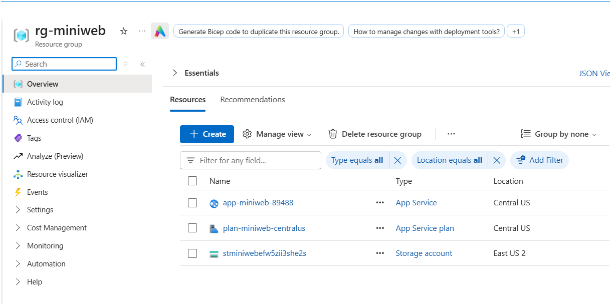

# Mini web con sincronización con Storage Account

Se crearon los módulos para configurar en Bicep el Storage Account con un mensaje y una carpeta para poder subir varios mensajes. Aparte, un `sh` para poder subir automáticamente al Storage los archivos `.txt`.

La web (App Service) lee los archivos del contenedor con su **identidad administrada**, que tiene asignado el rol **Storage Blob Data Reader**, y los muestra al final de la página principal.

**Demo:** https://app-miniweb-2897.azurewebsites.net

## Creación del resource group y el storage account



## Mensajes en el storage



## Servicios desplegados de la app web



## Estructura

| Ruta | Descripción |
|---|---|
| `modules/storage.bicep` | Storage Account y contenedor `mensajes`. |
| `mensajes/` | Archivos `.txt` que se suben al contenedor. |
| `deploy-storage.sh` | Despliega el Bicep y sube todos los `.txt` de `mensajes/`. |
| `web/` | Mini web: `server.js` (lee el Storage) y `public/` (página). |

## Desplegar el storage y subir mensajes

```bash
az login
./deploy-storage.sh rg-miniweb           # región por defecto: eastus2
```

Para agregar un mensaje, crea otro `.txt` en `mensajes/` y vuelve a ejecutar el script.

## Dar acceso a la web

```bash
az role assignment create \
  --assignee-object-id <principalId de la web> \
  --assignee-principal-type ServicePrincipal \
  --role "Storage Blob Data Reader" \
  --scope "<id del storage>/blobServices/default/containers/mensajes"
```

## Ejecutar la web en local

```bash
cd web
npm install
STORAGE_ACCOUNT_URL=https://<storage>.blob.core.windows.net/ node server.js
```

Abrir `http://localhost:8080`. En local, tu usuario necesita el rol Storage Blob Data Reader sobre el contenedor.
